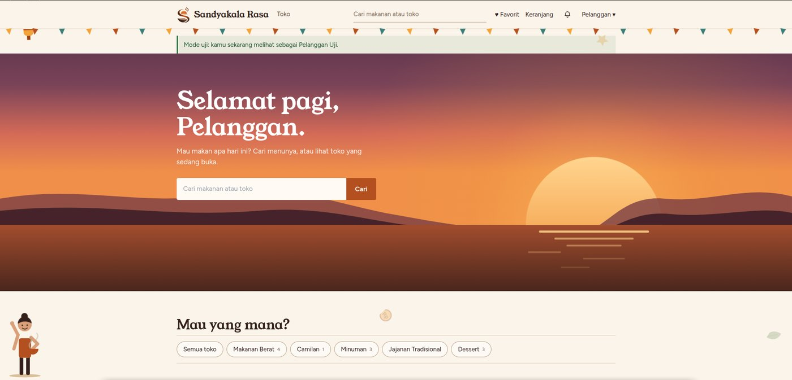
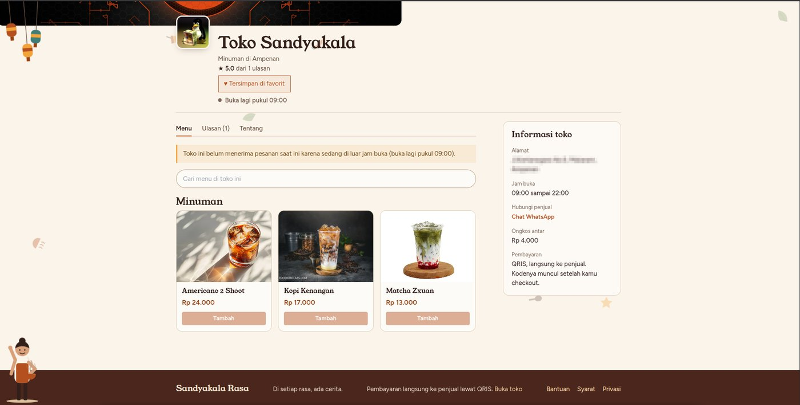
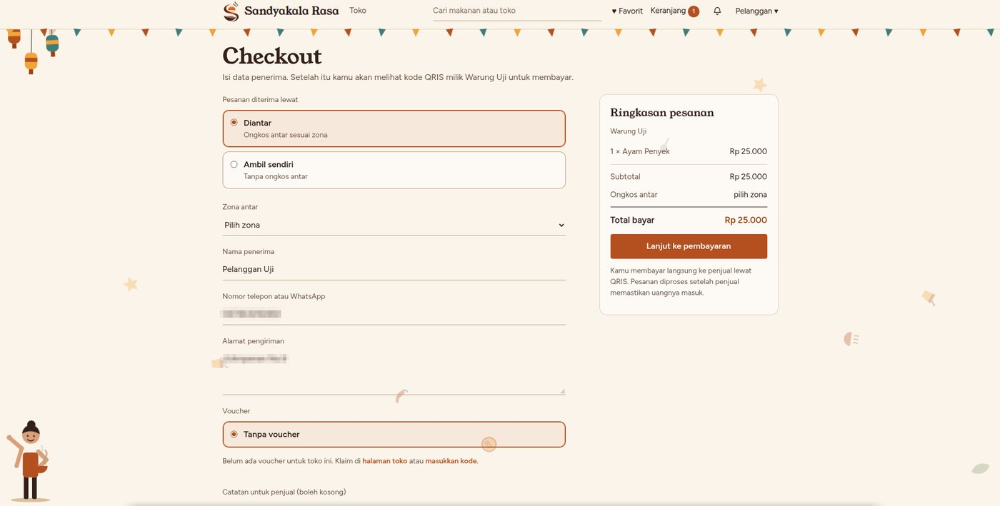
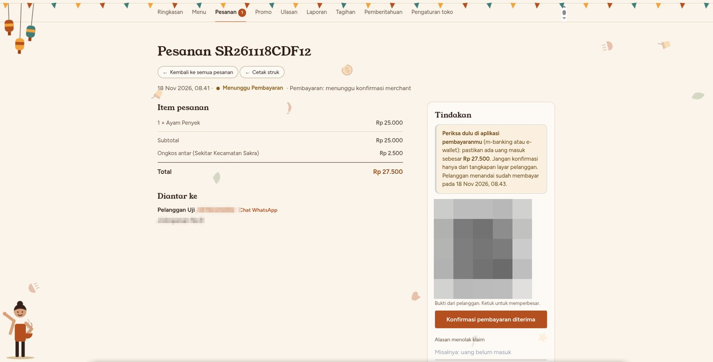
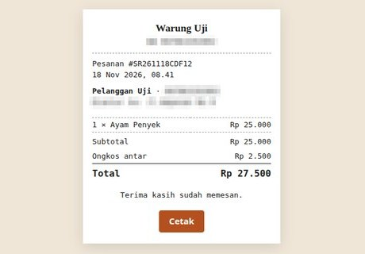

# Sandyakala Rasa — Marketplace UMKM Kuliner Lokal

<!-- tampilan-aplikasi:mulai -->


> **Di setiap rasa, ada cerita.** Marketplace UMKM kuliner lokal: penjual membuat toko online sendiri, pelanggan memesan lalu membayar langsung ke penjual lewat QRIS.

## Tampilan aplikasi

<p align="center">
  
</p>

| Halaman toko | Checkout |
|---|---|
|  |  |

| Pesanan di dashboard penjual | Struk pesanan |
|---|---|
|  |  |

> Data pada tangkapan layar adalah data uji. Nomor telepon, alamat, dan kode QR sengaja diburamkan.
<!-- tampilan-aplikasi:selesai -->


Versi Node.js (Express + EJS + Tailwind) dari blueprint V1: marketplace, toko merchant, menu,
keranjang, checkout, pembayaran QRIS langsung ke merchant (konfirmasi manual), pesanan,
ulasan, dashboard merchant, dan dashboard admin.

## Menjalankan di komputer (Linux Mint)

Butuh **Node.js 18 atau lebih baru** (cek: `node -v`).

```bash
cd sandyakala-rasa
cp .env.example .env        # lalu ubah SESSION_SECRET menjadi teks acak sendiri
npm install                 # otomatis membangun CSS juga
npm run setup               # membuat tabel database
npm run seed                # (opsional) data contoh: 4 toko, menu, pesanan, ulasan
npm run dev                 # buka http://localhost:3000
```

Jika `npm install` gagal pada `better-sqlite3`:
`sudo apt install build-essential python3` lalu ulangi `npm install`.

Jika tampilan tanpa gaya (polos), bangun CSS manual: `npm run build:css`.
Setelah mengubah class Tailwind di file `.ejs`, jalankan lagi `npm run build:css`
(atau `npm run watch:css` saat mengembangkan).

### Akun contoh (hanya dari `npm run seed`)

| Peran | Email | Password |
|---|---|---|
| Admin | admin@sandyakala.test | dicetak di terminal saat npm run seed |
| Pelanggan | budi@example.test | dicetak di terminal saat npm run seed |
| Merchant | sari@example.test | dicetak di terminal saat npm run seed |

QRIS pada data contoh hanya QR palsu untuk demo. **Jangan jalankan seed di server publik.**

### Membuat akun admin sungguhan

```bash
npm run create-admin -- emailkamu@gmail.com "Nama Kamu"
```
(Akan meminta password minimal 10 karakter.) Admin tidak bisa dibuat lewat halaman pendaftaran.

Panduan menaruh di internet: lihat `HOSTING.md`.

## Memakai MySQL (misalnya XAMPP) alih-alih SQLite

1. Buat database kosong `sandyakala_rasa` lewat phpMyAdmin (collation `utf8mb4_unicode_ci`).
2. Di `.env`: `DB_CLIENT=mysql` lalu isi `MYSQL_*`.
3. `npm run setup`.

## Alur utama

1. Merchant mendaftar → mengisi profil toko, menu, dan **mengunggah QRIS resmi miliknya**.
2. Admin memeriksa toko dan QRIS (menu Kelola Toko) lalu menyetujui. Toko baru tampil ke publik setelah disetujui.
3. Pelanggan memilih menu → keranjang (satu pesanan = satu toko) → checkout → melihat QRIS merchant.
4. Pelanggan membayar di aplikasi pembayarannya lalu menekan **"Saya Sudah Membayar"** (hanya klaim).
5. Merchant memeriksa uang masuk di aplikasi pembayarannya sendiri → **Konfirmasi Pembayaran Diterima**
   (dicatat siapa dan kapan). Pesanan lalu diproses → dikirim → selesai.
6. Pesanan yang tidak dibayar dalam 15 menit dibatalkan otomatis dan stok dikembalikan.

## Keamanan yang sudah diterapkan

- Password di-hash (bcrypt), sesi cookie `httpOnly` + `sameSite`, token CSRF di semua form.
- Pembatasan percobaan login/daftar, header keamanan + CSP (helmet), tanpa script inline.
- Harga, total, dan stok **selalu dihitung ulang di server** dari database.
- Setiap merchant hanya bisa mengakses toko/menu/pesanan miliknya; pelanggan hanya pesanannya sendiri.
- Upload gambar divalidasi dari isi file (bukan ekstensi), dibatasi 3 MB, nama file diacak.
- Daftar publik tidak bisa memilih peran admin.
- Bukti transfer **tidak** dianggap pembayaran sah; hanya konfirmasi merchant.
- QRIS baru/berubah wajib diverifikasi admin dulu.

## Belum ada (sesuai fase di blueprint)

- Lupa password otomatis lewat email/WhatsApp (sementara: admin membantu).
- Login Google/Apple, notifikasi real-time Node.js (Socket.IO) → fase V2.
- Payment gateway otomatis, kurir, dan pelacakan → V3.
- Tabel `addresses` terpisah: V1 menyimpan satu alamat bawaan di profil pengguna dan salinan alamat di setiap pesanan.

## Struktur folder

```
src/server.js          titik masuk aplikasi
src/routes/            auth, public, cart, orders, merchant, admin
src/lib/               database, skema tabel, helper, layanan pesanan, upload
src/middleware/        sesi, CSRF, pengecekan peran
views/                 tampilan (EJS)
public/                CSS hasil build, JavaScript ringan, logo
scripts/               setup, seed, create-admin
```

## Hosting

Aplikasi Node.js **tidak bisa** dijalankan di InfinityFree (hanya PHP). Pilihan umum: VPS
(paling fleksibel), atau layanan hosting Node.js. Untuk SQLite, folder `data/` dan `uploads/`
harus berada di penyimpanan yang **permanen**; kalau hosting menghapus file saat restart,
pakai MySQL eksternal dan penyimpanan gambar terpisah. Set `NODE_ENV=production` dan
`SESSION_SECRET` acak yang panjang, dan jalankan di belakang HTTPS.

## Pengaturan tambahan (`.env`)

- `APP_URL`: alamat situs saat online, dipakai untuk tautan atur ulang password dan pratinjau saat dibagikan.
- `CONTACT_EMAIL`, `CONTACT_WA`: kontak admin di halaman Bantuan, Syarat, Privasi, dan halaman masuk. Kalau kosong, bagian kontak tidak ditampilkan.

## Lupa password

Pengguna meminta tautan ke admin. Admin membuka **Pengguna**, memilih **Atur ulang password**, lalu mengirim tautan yang muncul (berlaku 1 jam, sekali pakai). Akun admin diatur ulang lewat `npm run create-admin`.

## Foto

Foto diperkecil otomatis dan metadatanya (termasuk lokasi GPS) dibuang memakai paket `sharp`. Jalankan `npm install` setelah memperbarui kode supaya paket ini terpasang.

## Pemberitahuan pesanan, cadangan, dan catatan error

- **WhatsApp:** daftar di gateway WA (misalnya fonnte.com), sambungkan satu nomor WA khusus platform dengan scan QR, lalu salin token ke `WA_GATEWAY_TOKEN` di `.env` dan restart. Penjual menerima kabar di nomor WhatsApp tokonya. Ini gateway tidak resmi, jadi jangan pakai nomor pribadi dan jangan kirim pesan massal.
- **Email (opsional):** jalankan `npm install` (memasang `nodemailer`), isi `SMTP_*` di `.env`.
- **Cadangan:** otomatis tiap 12 jam ke folder `backups/` (14 terakhir). Manual: `npm run backup`. Salin foldernya ke tempat lain secara berkala. Untuk MySQL pakai `mysqldump`.
- **Catatan error:** tersimpan di `logs/` (30 hari) dan tampil untuk admin di menu *Catatan error*.
